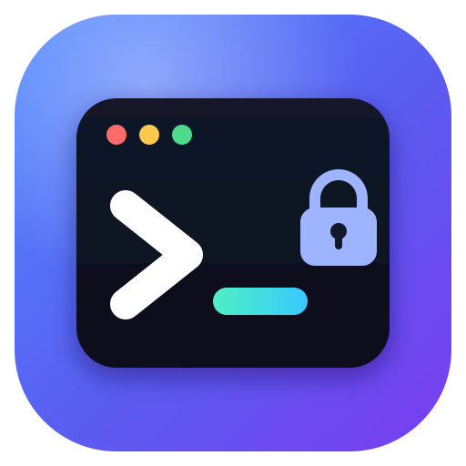
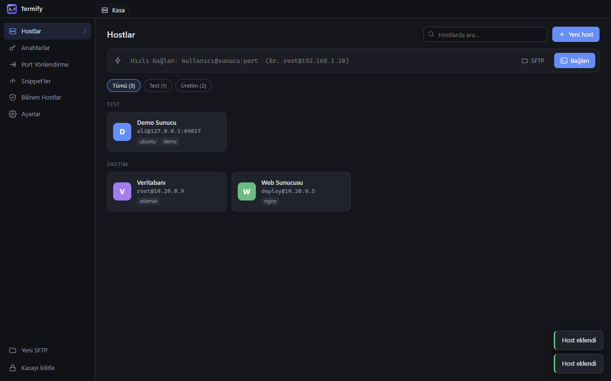
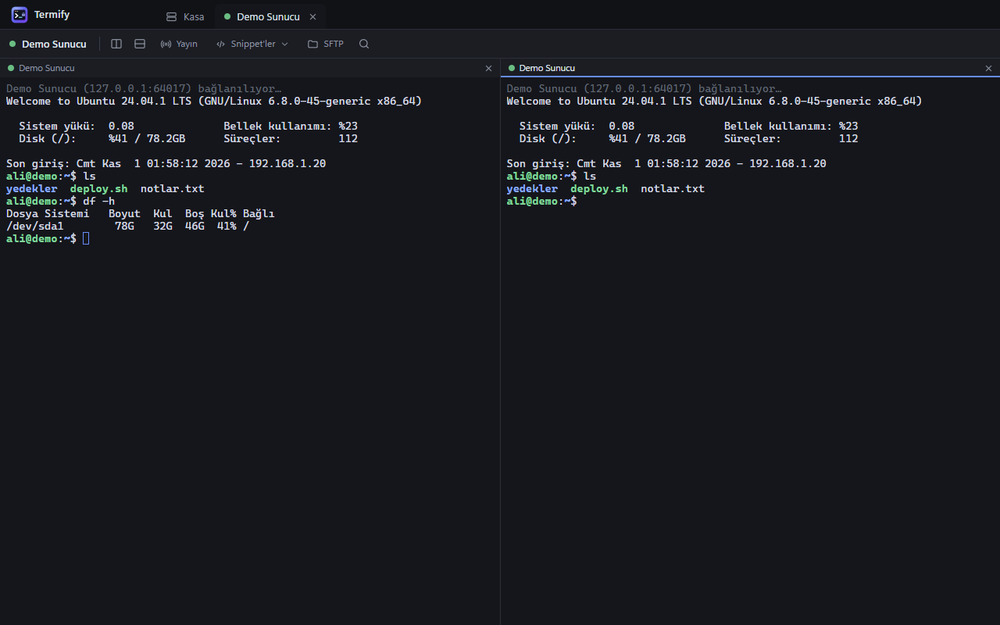
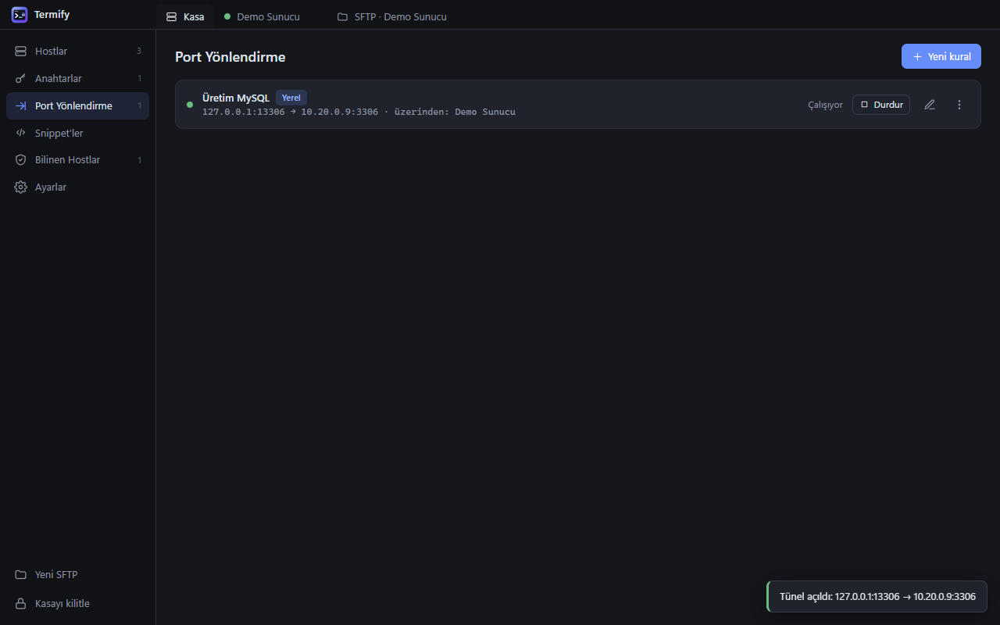
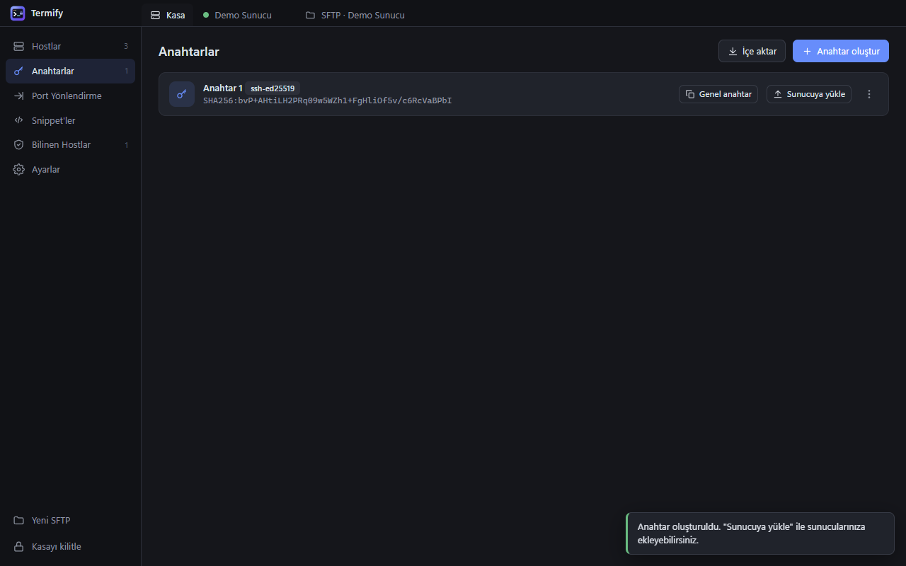
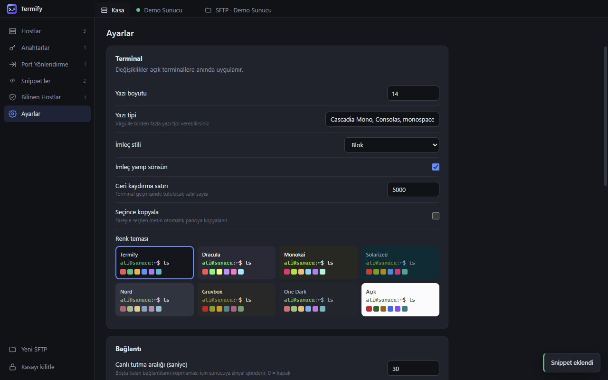

<p align="center">
  
</p>

<h1 align="center">Termify</h1>

<p align="center">
  Türkçe arayüzlü, modern bir masaüstü SSH istemcisi.<br />
  Terminal, SFTP, port yönlendirme ve anahtar yönetimi tek uygulamada.
</p>

<p align="center">
  <a href="https://github.com/Muhammed61/termify-releases/releases/latest"><b>⬇ İndir: Windows (.exe) · macOS (.dmg) · Linux / Kali (.deb, AppImage)</b></a>
</p>



## Kurulum

**Windows:** [Releases](https://github.com/Muhammed61/termify-releases/releases/latest) sayfasından `Termify-Setup-x.y.z.exe` dosyasını indirip çalıştırın. Kurulum dosyası imzasız olduğu için Windows SmartScreen uyarı verebilir: **Ek bilgi → Yine de çalıştır** deyin.

**macOS:** Apple Silicon (M1/M2/M3/M4) için `Termify-x.y.z-arm64.dmg`, Intel Mac için `Termify-x.y.z-x64.dmg` dosyasını indirin, açın ve Termify'yi **Uygulamalar** klasörüne sürükleyin. Uygulama Apple sertifikasıyla imzalı olmadığı için ilk açılışta uyarı çıkar: **Sistem Ayarları → Gizlilik ve Güvenlik → Yine de Aç**. "Hasarlı" uyarısı çıkarsa Terminal'de bir kez `xattr -cr /Applications/Termify.app` çalıştırın. macOS 12 veya üstü gerekir. Mac'te kısayollar Ctrl+Shift yerine Cmd ile çalışır (ör. Cmd+T, Cmd+W, Cmd+D).

**Kali Linux / Debian / Ubuntu:** `Termify-x.y.z-amd64.deb` (ARM cihazlarda `arm64.deb`) dosyasını indirip `sudo apt install ./Termify-x.y.z-amd64.deb` ile kurun, menüden ya da `termify` komutuyla açın. Root kullanıcısıyla açarken `termify --no-sandbox` gerekir. Kurulumsuz kullanım için `.AppImage` dosyası da var (`libfuse2` gerekir).

İlk açılışta bir **ana parola** belirlersiniz. Tüm hostlarınız, parolalarınız ve anahtarlarınız bu parolayla şifrelenir.

## Özellikler

- **Şifreli kasa:** Her şey ana parolayla veya 4+ haneli PIN ile AES-256-GCM (scrypt) şifrelenir. Parolayı unutursanız kurtarma anahtarıyla yeni parola belirlersiniz. Boşta kalınca otomatik kilitlenir.
- **Hostlar:** Gruplar, etiketler, renkler, arama. Hızlı bağlan (`kullanici@sunucu:port`), atlama sunucusu (ProxyJump) ve başlangıç komutu desteklenir.
- **Terminal:** Sekmeler, dikey/yatay bölme (4 panele kadar), yayın modu (tüm panellere aynı anda yazma), arama, 8 renk teması. Bağlantı koparsa Enter ile yeniden bağlanır.
- **SFTP:** Çift panel (bilgisayar ↔ sunucu), sürükle-bırak (Windows Gezgini'nden de), klasör aktarımı, ilerleme çubuğu, uzak dosya düzenleme, izin değiştirme.
- **Anahtarlar:** Ed25519/RSA/ECDSA anahtar üretme, içe aktarma, tek tıkla sunucuya yükleme (`ssh-copy-id` gibi).
- **Port yönlendirme:** Yerel (-L), uzak (-R) ve dinamik SOCKS5 (-D) tüneller.
- **Snippet'ler:** Sık kullanılan komutları kaydedip terminalde tek tıkla çalıştırma.
- **Bilinen hostlar:** Sunucu parmak izi doğrulama; parmak izi değişirse uyarı.
- **Yedekleme ve eşitleme:** Şifreli `.termify` yedek dosyası. Dosyayı Google Drive/OneDrive klasörüne koyup başka bilgisayarda içe aktarabilirsiniz.

| Terminal (bölünmüş ekran) | Port yönlendirme |
|---|---|
|  |  |

| Anahtarlar | Ayarlar ve temalar |
|---|---|
|  |  |

## Geliştirme

```
npm install
npm start
```

Ya da `baslat.bat` dosyasına çift tıklayın. Kurulum dosyası üretmek için `npm run dist` (Windows), bir Mac'te `npm run dist:mac` veya Linux'ta `npm run dist:linux` çalıştırın (çıktı `dist/` klasörüne gelir).

Sürüm yayınlamak için `package.json` içindeki sürümü artırıp aynı adla etiket gönderin (ör. `v1.0.2`). GitHub Actions Windows, macOS ve Linux kurulum dosyalarını derleyip public [termify-releases](https://github.com/Muhammed61/termify-releases) deposuna yükler; kurulu uygulamalar yeni sürümü kendiliğinden bulur (Windows ve Linux kendini günceller; Mac'te uygulama imzasız olduğu için bildirimdeki "İndir" yeni .dmg dosyasını tarayıcıda açar). Bunun için bu depoda `RELEASES_TOKEN` secret tanımlı olmalı (termify-releases için Contents: Read and write).

### Klasör yapısı

- `main.js`: Electron ana süreç ve IPC
- `preload.js`: Arayüze açılan güvenli API
- `src/main/`: Kasa, SSH bağlantısı, oturumlar/SFTP, port yönlendirme, anahtarlar
- `renderer/`: Arayüz (HTML/CSS/JS modülleri)

Veriler şifreli olarak `%APPDATA%\Termify\kasa.json` (Windows) `~/Library/Application Support/Termify/kasa.json` (macOS) veya `~/.config/Termify/kasa.json` (Linux) dosyasında saklanır.

## Katkıda bulunma

Termify açık kaynaklıdır; hata bildirimleri, öneriler ve katkılar memnuniyetle karşılanır.

- **Hata veya öneri:** [Issues](https://github.com/Muhammed61/termify/issues) bölümünden yeni bir kayıt açın. Hatayı nasıl tekrarlayabileceğimizi, işletim sisteminizi ve Termify sürümünüzü (Ayarlar → Güncellemeler) yazın.
- **Kod katkısı:** Depoyu fork'layın, değişikliğinizi ayrı bir dalda yapın ve Pull Request gönderin. Arayüz metinleri Türkçedir; yeni metinleri de Türkçe yazın.
- **Güvenlik açığı:** Termify parolalarınızı ve SSH anahtarlarınızı sakladığı için güvenlik açıklarını herkese açık Issue olarak yazmayın. GitHub'daki **Security → Report a vulnerability** bölümünden gizli olarak bildirin.

## Lisans

[MIT](LICENSE). Electron, xterm.js ve ssh2 ile geliştirildi.
